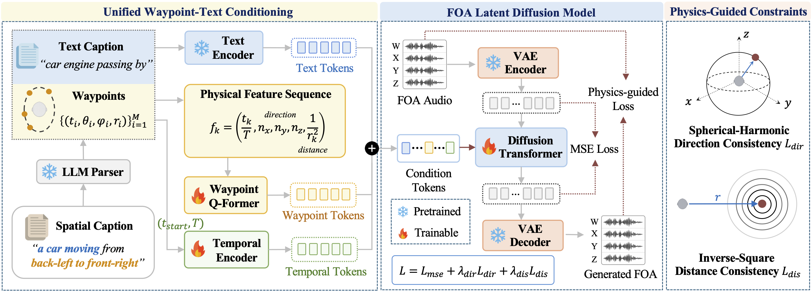

<div align="center">

# PhysWave: Physics-Guided Spatial Audio Generation with Controllable Latent Diffusion Models (EMNLP 2026)

</div>

<div align="center">
  <a href="https://arxiv.org/abs/2608.29549"></a>&nbsp;
  <a href="https://lingfengyao.github.io/PhysWave/"></a>&nbsp;
  <a href="https://huggingface.co/10wind/PhysWave"></a>&nbsp;
  <a href="https://huggingface.co/datasets/10wind/PhysWave_dataset"></a>
</div>


<div align="center">
  
</div>

PhysWave generates single-source spatial audio from a sound description and trajectory.
Use a natural-language instruction parsed by an API, or provide waypoints directly.
Outputs are approximately 10 seconds of 16 kHz first-order ambisonic (FOA) audio.
For headphone listening, render the FOA output to binaural audio using an HRTF-based decoder.

## Release Status

- [x] Demo audio
- [x] Inference code
- [x] [Checkpoints](https://huggingface.co/10wind/PhysWave)
- [x] [Dataset](https://huggingface.co/datasets/10wind/PhysWave_dataset)

## Setup

Use Python 3.10 and a CUDA GPU:

```bash
git clone https://github.com/lingfengyao/PhysWave.git
cd PhysWave
python -m venv .venv
source .venv/bin/activate
python -m pip install -e .
```

Download both pretrained checkpoints from [Hugging Face](https://huggingface.co/10wind/PhysWave):

```bash
python -m pip install huggingface_hub
hf download 10wind/PhysWave physwave.ckpt vae.ckpt --local-dir checkpoints
```

The checkpoint directory should contain:

```text
checkpoints/
  physwave.ckpt
  vae.ckpt
```

T5-base is downloaded from Hugging Face on first use. All commands below run
from this directory and use seed 0, 100 sampling steps and CFG 6 by default.

## Natural-language input

An API converts the instruction into a sound caption and trajectory.
Use one sound source over a 10-second clip.

By default, the parser uses Gemini 2.5 Flash Lite through OpenRouter:

```bash
export OPENROUTER_API_KEY="your-api-key"

python -m physwave \
  --instruction "A telephone rings on the right at azimuth 92 degrees, elevation -10 degrees and distance 1.6 metres, staying there for 10 seconds." \
  --output outputs/telephone_instruction.wav

python -m physwave \
  --instruction "Keyboard typing moves counterclockwise around the listener from azimuth 60 degrees on the right to azimuth -65 degrees on the left over 10 seconds, staying at ear level and 2 metres away." \
  --output outputs/keyboard_instruction.wav

python -m physwave \
  --instruction "A person snores behind-left at azimuth -130 degrees and elevation 20 degrees, approaching from 8 metres to 0.8 metres over 10 seconds." \
  --output outputs/snoring_instruction.wav
```

For Google's Gemini API directly:

```bash
export GEMINI_API_KEY="your-api-key"

python -m physwave --provider google --gemini-model gemini-2.5-flash-lite \
  --instruction "A dog barks at the front-right, azimuth 40 degrees, elevation 10 degrees and distance 1 metre, staying there for 10 seconds." \
  --output outputs/dog_instruction.wav
```

To use another model through OpenRouter, pass `--provider openrouter --gemini-model <provider/model-id>`. The model must support JSON output;
other models have not been tested. Add `--parse-only` to inspect the parsed
condition without generating audio.

## Waypoint input

No API key is needed. Each JSON file contains an acoustic `caption` and
`waypoints`, with rows `[time_s, azimuth_deg, elevation_deg, distance_m]`:

```json
{
  "caption": "telephone ringing",
  "waypoints": [[0, 92, -10, 1.6], [10, 92, -10, 1.6]]
}
```

Times must increase from 0 to 10 seconds. Azimuth is 0° in front, −90° on the
left, +90° on the right and ±180° behind. Elevation ranges from −90° to +90°;
positive is above the listener. Distance must be at least 0.5 m. Values are
interpolated between waypoints; use continuous angles across ±180° (170 → 190).

```bash
# Static telephone and dog
python -m physwave --condition examples/telephone_static.json --output outputs/telephone.wav
python -m physwave --condition examples/dog_static.json --output outputs/dog.wav

# Keyboard arc and snoring pass-by
python -m physwave --condition examples/keyboard_arc.json --output outputs/keyboard.wav
python -m physwave --condition examples/snoring_pass_by.json --output outputs/pass_by.wav

# Approaching and receding snoring
python -m physwave --condition examples/snoring_approach.json --output outputs/approach.wav
python -m physwave --condition examples/snoring_recede.json --output outputs/recede.wav
```

Each run saves a WAV and a JSON file with its conditioning and generation settings.

## Dataset

The [PhysWave Dataset](https://huggingface.co/datasets/10wind/PhysWave_dataset) provides
pre-rendered 16 kHz FOA audio with captions and trajectory waypoints in Parquet format.

## Citation

If you use PhysWave in your research, please cite:

```bibtex
@inproceedings{yao2026physwave,
  title={PhysWave: Physics-Guided Latent Diffusion Models for Controllable Spatial Audio Generation},
  author={Yao, Lingfeng and Huang, Chenpei and Yang, Xingke and Geng, Ziye and Luo, Changqing and Wang, Hao and Liu, Jiang and Pan, Miao},
  booktitle = {Proceedings of the 2026 Conference on Empirical Methods in Natural Language Processing},
  year      = {2026}
}
```
